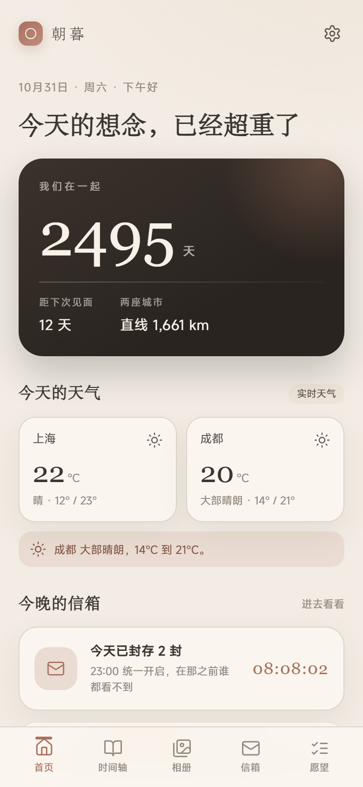
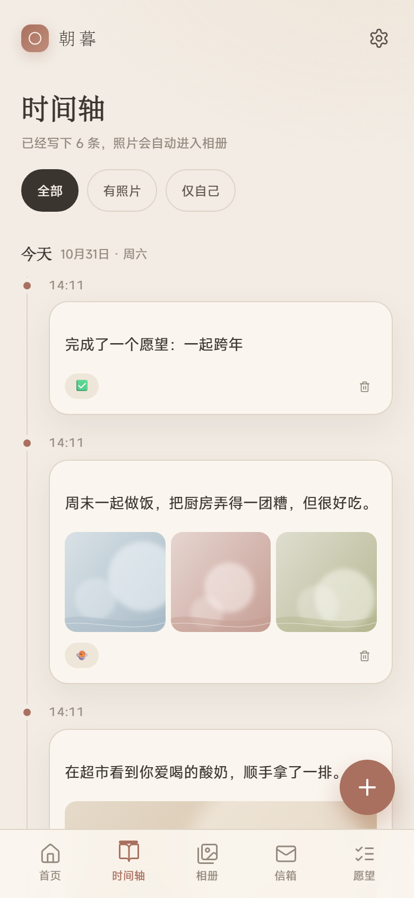
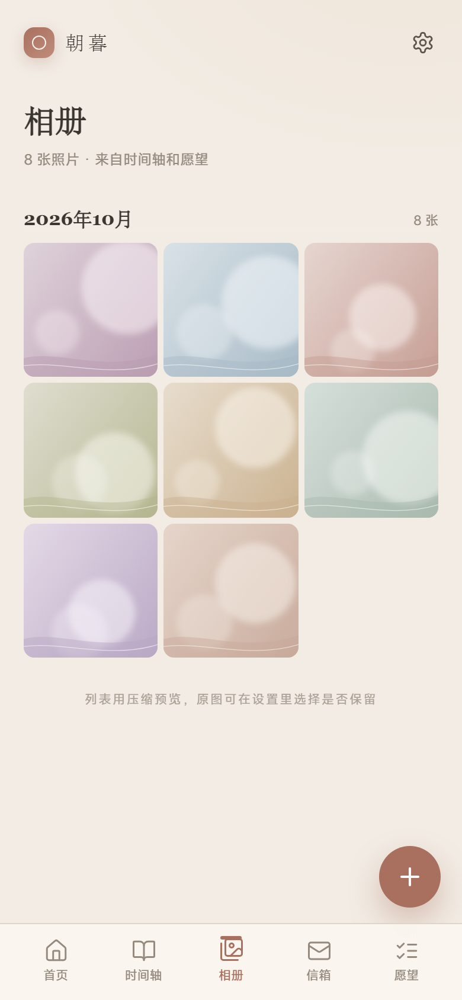
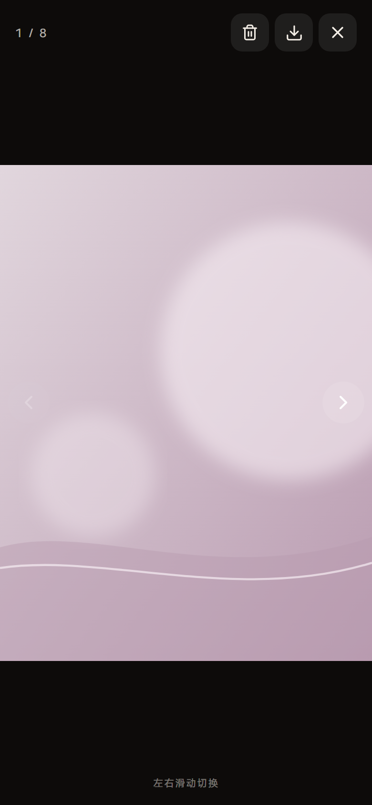
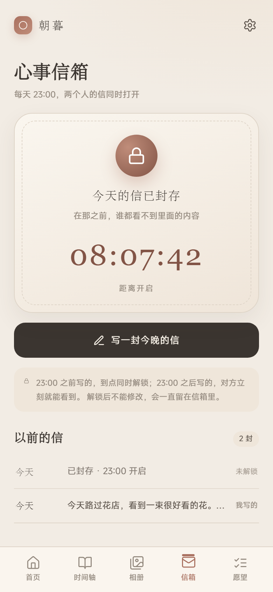
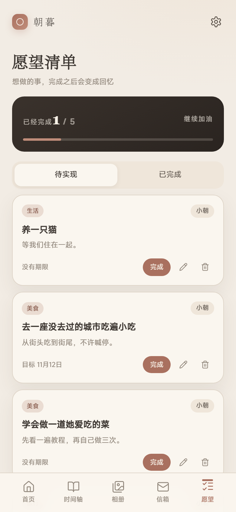

# 朝暮 · Zhaomu

A private two-person memory site: timeline, photo album, 23:00 mailbox, wish list, two-city weather, anniversaries and a meeting countdown.

两个人的私密小站：时间轴、相册、23:00 心事信箱、愿望清单、两地天气、纪念日和见面倒计时。

[中文](#中文) · [English](#english)

> This repository contains source code and generic demo data only. No real records, photos, voices or Cloudflare credentials are included.
>
> 仓库只包含源代码和通用演示数据，不包含任何真实记录、照片、语音或 Cloudflare 凭据。

## Screenshots / 截图

<table>
  <tr>
    <td></td>
    <td></td>
    <td></td>
  </tr>
  <tr>
    <td align="center"><sub>首页 / Home</sub></td>
    <td align="center"><sub>时间轴 / Timeline</sub></td>
    <td align="center"><sub>相册 / Album</sub></td>
  </tr>
  <tr>
    <td></td>
    <td></td>
    <td></td>
  </tr>
  <tr>
    <td align="center"><sub>大图 / Viewer</sub></td>
    <td align="center"><sub>心事信箱 / Mailbox</sub></td>
    <td align="center"><sub>愿望清单 / Wishes</sub></td>
  </tr>
</table>

---

## 中文

### 功能

- **时间轴**：文字、心情、照片、语音；支持「仅自己可见」
- **相册**：上传、预览、原图下载、独立照片删除
- **心事信箱**：每天 23:00 定时解锁，支持文字和语音；未解锁时服务端不返回正文
- **愿望清单**：新增、编辑、完成、撤回、删除；完成时自动生成一条时间轴回忆
- **两地天气**：Open-Meteo 实时天气，按经纬度计算直线距离
- **纪念日**：在一起的日子、两个生日、自定义纪念日
- **首页**：每日轮换短句、倒计时、纪念日横滑卡片
- **戳一下**：每天最多 5 次，对方下次打开首页能看到未读
- **设置**：城市、纪念日、主题色、深色模式、照片质量策略、数据导出

### 技术栈

- React 18 + TypeScript + Vite 6
- React Router 6、dayjs
- Hono 4
- Cloudflare Workers、D1、R2
- 手写 CSS，移动端优先，Morandi 低饱和主题

### 本地运行

```bash
pnpm install
cp .dev.vars.example .dev.vars
```

需要两个终端：

```bash
# 终端 1：本地 Workers API，端口 8787
pnpm dev:api

# 终端 2：前端，端口 5173
pnpm dev
```

打开 `http://localhost:5173`，首次会进入初始化页：

- 本地初始化码：`zhaomu-setup`
- 创建两个账号后，第一个账号会自动登录

### 演示数据

```bash
pnpm db:seed
```

会写入两个演示账号和一组通用示例数据：

| 名字 | 邮箱 | 密码 |
| --- | --- | --- |
| 小朝 | `a@zhaomu.local` | `test12345` |
| 小暮 | `b@zhaomu.local` | `test12345` |

从空数据重来：

```bash
pnpm db:reset
```

### 部署

完整步骤见 [部署指南](部署指南.md)。核心命令：

```bash
npx wrangler login
npx wrangler d1 create zhaomu
npx wrangler r2 bucket create zhaomu-media
cp wrangler.example.jsonc wrangler.jsonc
npx wrangler d1 migrations apply zhaomu --remote
pnpm build
npx wrangler deploy
```

把 `wrangler.jsonc` 里的 `database_id` 和 `SETUP_CODE` 换成自己的值。真实的 `wrangler.jsonc`、`.dev.vars` 已被 `.gitignore` 忽略。

### 隐私与安全

- 密码使用 PBKDF2-SHA256（100,000 次，Cloudflare Workers Web Crypto 上限）
- 会话使用 HttpOnly Cookie，30 天有效
- 「仅自己」的记录在 SQL 层过滤，对方拿不到
- 未解锁的信件只返回 `locked`，不返回正文和语音地址
- 私密记录里的媒体返回 403
- 生产环境拒绝 SVG 上传
- 照片上传会生成 480px 缩略图、1600px 预览和可选原图；列表用缩略图，点开先显示预览，再在后台加载原图
- 照片质量可选「高清压缩（2048px）」「相机原图（慢）」「只存压缩图」；旧照片会在相册加载时自动补缩略图

### 项目结构

```text
src/            前端页面、组件、API 客户端
worker/         Hono API、鉴权、媒体和 D1/R2 访问
migrations/     D1 表结构与默认设置
scripts/        本地种子数据、截图、开发检查脚本
public/         图标、manifest、演示用抽象图
docs/           README 截图
```

### 已知限制

- 列表有 480px 缩略图，点开使用 1600px 预览；没有更多尺寸的裁剪版本
- HEIC 照片会被拦截，需要兼容格式或截图
- 语音格式跟随浏览器，跨浏览器兼容性有限
- 农历生日和农历纪念日还没做
- 地图足迹、每日一问、年度报告还没做
- 没有密码重置、登录限流

### License

MIT

---

## English

### Features

- **Timeline**: text, mood, photos and voice messages, with private entries
- **Album**: upload, preview, original download and standalone photo deletion
- **Mailbox**: unlocks daily at 23:00, supports text and voice; locked bodies are never sent by the server
- **Wishes**: create, edit, complete, undo and delete; completing a wish creates a timeline memory
- **Two-city weather**: live Open-Meteo data and straight-line distance from coordinates
- **Anniversaries**: together since, two birthdays and custom anniversaries
- **Home**: daily rotating notes, countdown and anniversary cards
- **Nudge**: up to 5 times a day; the other person sees unread nudges on the home page
- **Settings**: cities, anniversaries, themes, dark mode, photo quality policy and data export

### Stack

- React 18 + TypeScript + Vite 6
- React Router 6 and dayjs
- Hono 4
- Cloudflare Workers, D1 and R2
- Hand-written CSS, mobile-first, low-saturation Morandi themes

### Getting started

```bash
pnpm install
cp .dev.vars.example .dev.vars
```

Run two terminals:

```bash
# Terminal 1: local Workers API on 8787
pnpm dev:api

# Terminal 2: frontend on 5173
pnpm dev
```

Open `http://localhost:5173`.

- Local setup code: `zhaomu-setup`
- After creating the two accounts, the first one is signed in automatically

### Demo data

```bash
pnpm db:seed
```

This creates two demo accounts and generic sample data.

| Name | Email | Password |
| --- | --- | --- |
| Xiaochao | `a@zhaomu.local` | `test12345` |
| Xiaomu | `b@zhaomu.local` | `test12345` |

Reset to an empty database:

```bash
pnpm db:reset
```

### Deploy

See [the deployment guide](部署指南.md) for the full walkthrough. Core commands:

```bash
npx wrangler login
npx wrangler d1 create zhaomu
npx wrangler r2 bucket create zhaomu-media
cp wrangler.example.jsonc wrangler.jsonc
npx wrangler d1 migrations apply zhaomu --remote
pnpm build
npx wrangler deploy
```

Fill in your own `database_id` and `SETUP_CODE` in `wrangler.jsonc`. The real `wrangler.jsonc` and `.dev.vars` are ignored by git.

### Privacy and security

- Password hashing: PBKDF2-SHA256, 100,000 iterations (the Cloudflare Workers Web Crypto limit)
- HttpOnly session cookie, valid for 30 days
- Private entries are filtered in SQL and never returned to the other account
- Locked letters return only `locked`; neither the body nor the voice URL is sent
- Media attached to private entries returns 403 to the other account
- SVG uploads are rejected in production
- Photos get a 480px thumbnail, a 1600px preview and an optional original; lists use the thumbnail, and the viewer shows the preview while the original loads in the background
- Photo quality can be "High compression (2048px)", "Camera original (slow)" or "Compressed only"; old photos get thumbnails backfilled when the album is opened

### Project layout

```text
src/            React pages, components and API client
worker/         Hono API, auth, media and D1/R2 access
migrations/     D1 schema and default settings
scripts/        Seed data, screenshots and development checks
public/         Icons, manifest and generic demo images
docs/           README screenshots
```

### Limitations

- Lists use 480px thumbnails and 1600px previews; there are no additional crop sizes
- HEIC uploads are rejected; use a compatible format or a screenshot
- Voice format depends on the browser and may not be portable across browsers
- Lunar birthdays and lunar anniversaries are not implemented
- Map footprints, daily questions and yearly reports are not implemented
- No password reset or login rate limiting

### License

MIT

---

If this project helped you, a star is appreciated.  
如果这个项目对你有帮助，欢迎点一个 star。
